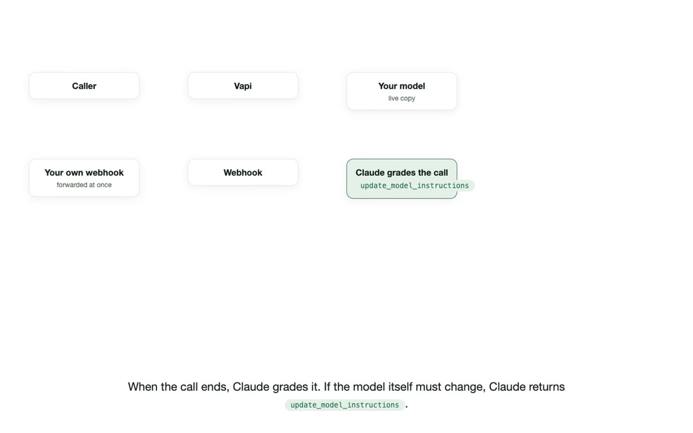
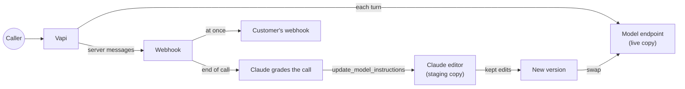

#  Vengram

<video src="docs/demo.mp4" poster="docs/demo.jpg" controls width="100%"></video>

[Watch the demonstration (MP4)](docs/demo.mp4)

Vengram serves a local language model to [Vapi](https://vapi.ai) as a custom LLM, and it changes the weights of that model after calls that go wrong. It does not train the model and it does not change the prompt.

## 1. Method

1. A Vapi assistant uses the Vengram model through an OpenAI-compatible endpoint.
2. Vapi sends its server messages to the Vengram webhook. Vengram forwards each message at once to the customer's own webhook, if one is set.
3. At the end of a call, Claude grades the call against the assistant's system prompt. If the model itself must change, the grade contains `update_model_instructions`: what to do differently and a corrected reply for one turn.
4. A Claude editor reads the model at the points where its reply differs from the corrected reply (logit lens and per-layer effects). It then applies rank-one weight edits, $W' = W + \alpha\, u v^{\top}$, to a staging copy of the model, evaluates each edit, and keeps an edit only if regression agreement on other prompts stays at or above 0.95.
5. Kept edits become a new model version. The live copy of the model is replaced with that version in one locked step, so calls are not blocked while the editor works. Any earlier version, or the base model, can be made live again.

## 2. Run with Docker

1. Copy `.env.example` to `.env`, and set `ANTHROPIC_API_KEY` and `NGROK_AUTHTOKEN`.
2. Set the model in `config.json`. The value is a Hugging Face model id, or a folder under `./models`, written as `/models/<folder>`.
3. Start the server:

       docker compose up --build

The server opens an ngrok tunnel and prints the public address. To change the model, edit `config.json` and restart the container. Each base model keeps its own versions, so a new model starts at version 0.

The server holds two copies of the model, one for calls and one for edits. Qwen2.5-0.5B-Instruct uses about 5.5 GB of memory in the container, and Qwen2.5-1.5B-Instruct needs about 14 GB. In Docker the model runs on the CPU.

## 3. Run without Docker

    pip install -r requirements.txt
    ANTHROPIC_API_KEY=sk-ant-... python server.py --config config.json

On a Mac with Apple silicon, the model runs on the GPU. To skip ngrok on a host that already has a public address, set `public_url` in the config.

## 4. Use

Open the dashboard at http://127.0.0.1:8790. The dashboard answers only on the local computer, and it has no sign-in.

1. Create a project. Each project gets a secret Custom LLM URL and a secret Server URL.
2. In Vapi, set the assistant's model to Custom LLM with the Custom LLM URL, and set its Server URL with End Of Call Report turned on.
3. Calls appear under Calls with their grade, any `update_model_instructions`, and the editor's steps. Versions appear under Model.

## 5. Notes

- All projects share one model, so an update from one project changes the model for every project.
- The number of model updates per day is set in the dashboard.
- Data stays in `~/.engram/live/` (`/data` in Docker): projects, calls, transcripts, and versions. The Claude grader receives the call transcript.
- To set up Vengram with an agent, open this folder in Claude Code and run `/setup`.

## 6. Background

Vengram applies weight-space programming, in which a general-purpose language model reads and writes the weights of another network without gradient descent.

> Rikiya Takehi, Jayden Teoh, Alex Zhang, and Omar Khattab. "Sparks of Weight-Space Programming: LLMs can natively read & write neural network weights." MIT Computer Science and Artificial Intelligence Laboratory, November 2, 2026.
